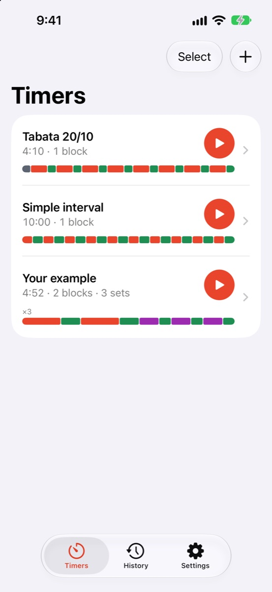
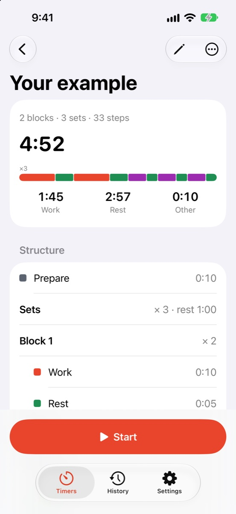
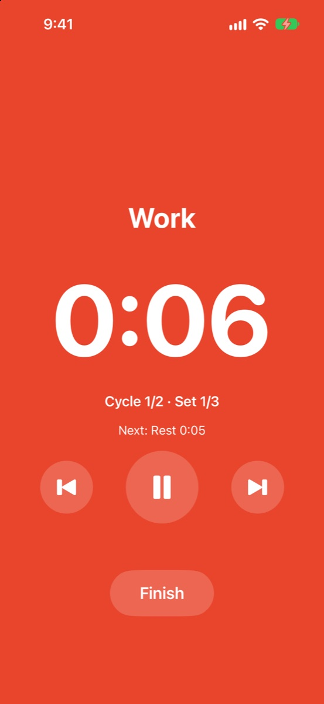
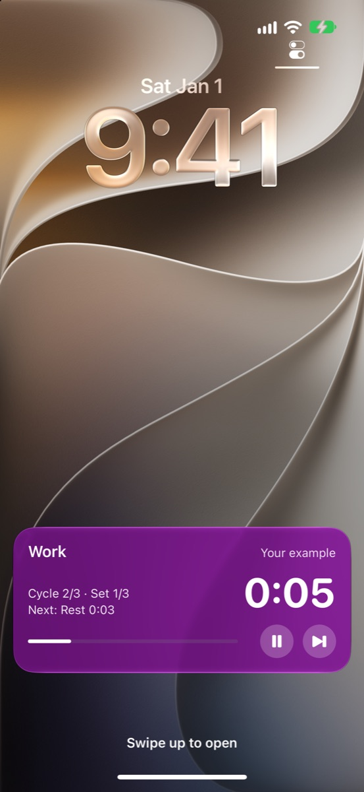

<h1 align="center">SetLoop</h1>

Interval timer for iPhone — blocks, sets, any combination. 
<a href="https://personan1.github.io/SetLoop/">Website</a> · <a href="https://t.me/setnewloop">Telegram</a> · <a href="https://personan1.github.io/SetLoop/support/">Support</a> · <a href="https://personan1.github.io/SetLoop/privacy/">Privacy</a>

**Status:** in development, coming soon to the App Store.

## How it works

- **Step** — a stretch of time: work, rest, prepare or cooldown. Each type has its own color.
- **Block** — a few steps repeated as many times as you need, e.g. 20 s work + 10 s rest ×8.
- **Set** — all blocks in order; sets repeat with rest between them.
- **Workout** — optional prepare, the sets, optional cooldown. The whole thing is shown as one colored strip.

## Features

- Six step types with customizable colors; ready-made timers such as Tabata.
- Sounds, voice prompts and vibration; option to ignore the Silent switch.
- Live Activity on the Lock Screen and in the Dynamic Island, with pause and skip.
- Workout history.
- Light and dark theme, Russian and English.
- iOS 17+, iPhone. Free, no ads, no accounts, no data collected.

## Contact

News and questions — Telegram [@setnewloop](https://t.me/setnewloop). Bug reports are also welcome in [GitHub Issues](https://github.com/PersonaN1/SetLoop/issues).

## Documentation

- [Product spec](docs/SPEC.md)
- [Design](docs/DESIGN.md)
- [Technical design](docs/TECH.md)

## Support the project

SetLoop is free and has no ads. If you like it, you can [buy the developer a coffee](https://pay.cloudtips.ru/p/7fee0c9b) ☕

## License

Copyright © 2026. All rights reserved. The source code is published for reference only; no license is granted to copy, modify or distribute it.
